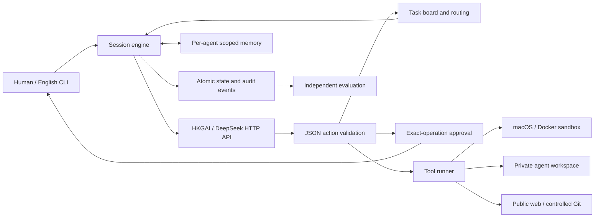

# 系统架构

## 执行路径



`SessionEngine` 是单进程、串行 actor 调度器。当前成员的模型决定下一动作：委派给谁、发送消息、调用工具、提出问题、提交子任务、审核或完成总体任务。串行执行便于复现、避免写入冲突，不固定为“开发→测试→发布”的脚本。多个独立会话可在不同进程运行，同一会话通过文件锁拒绝并发写入。

所有成员使用相同指定模型，异构性由各自的身份、职责、上下文、记忆和独立工作区构成。自定义角色从 JSON 注入。

## 动作协议

模型每次仅返回一个带有顶层 `action` 的 JSON 对象。例如：

```json
{"action":"delegate","recipient":"dev","task":"Implement conflict detection","success_criteria":"Overlapping reservations are rejected; adjacent ones are accepted."}
```

工具动作使用 `{"action":"tool","name":"read_file","arguments":{"path":"README.md"}}`。`complete` 仅提交子任务，`review` 由不同成员执行，`finish` 仅协调者可执行。协议验证参数类型、字段、成员身份和任务状态。连续三个无效动作停止当前任务；所有循环有回合预算。

子任务状态：`assigned → submitted → accepted / failed`。失败可通过带 `retry_of` 的新委派替代，旧记录标记 `superseded` 并保留在指标分母中。成功完成总体任务要求至少一项独立成员审核通过，且全部有效子任务已通过。

提交时检查产物存在、路径边界与 SHA-256，审核时重新检查哈希，防止提交后静默变化。同伴可能判断错误，因此这只是同伴审核；独立评测仍须验证实际内容或由人类评分。

## 人类参与与恢复

`ask_human` 保存具体问题并进入 `waiting_human`。关键工具由工具层与编排层双重检查，不是仅靠提示词。审批包括具体参数、操作摘要及工作区指纹，明确批准后才执行；指纹变化则要求重新申请。

状态通过临时文件写入、fsync、原子替换保存。工具执行前先记录 `inflight`，结束后清除。若进程在外部效果产生后、记录结果前崩溃，恢复时请求真人核对实际结果，避免重复提交或重复推送。系统不声称分布式“恰好一次”语义。

`budget_exhausted` 是可恢复状态；`failed` 表示当前任务终止。新任务沿用同一团队，归档之前状态，保留已生成文件、对话上下文与记忆。

## 隔离边界

工具操作使用相对路径验证和基于目录文件描述符的 `O_NOFOLLOW` 打开，拒绝遍历、链接和不支持的文档格式。私有目录与记忆以受限文件权限创建。跨成员分享只复制指定文件到接收方 inbox，并返回哈希收据。

运行模型生成的 Python 时由 OS/container 提供隔离：

- macOS Seatbelt 默认拒绝，仅放行系统运行库、Python 标准库及自己的工作区。拒绝网络和子进程，启动环境使用白名单。
- Docker root 文件系统只读，关闭网络、删除 capabilities、禁止新增权限，只绑定本人的工作区，限制进程/CPU/内存，超时清理容器。

文件、网络、代码、Git 的权限分别在工具层实施。沙箱没有可用后端时明确失败，绝不降级为普通宿主 subprocess。此设计不针对控制宿主操作系统的攻击者，也不把提示词本身当成安全隔离。

网页抓取验证全部 DNS 地址为公开地址，固定实际连接 IP并保留 TLS 主机校验，每次重定向重新验证。禁用代理环境继承，限制响应体积和 HTTP 请求时间。系统 DNS 解析由操作系统处理，不能被 HTTP 截止时间强制中断，因此解析器异常可能延长等待。网站变更、反爬或搜索服务故障会作为工具错误交给智能体处理。

Git 仅操作当前工作区，清理外部配置及环境，禁用钩子、外部 diff、凭据助手等扩展。推送只允许 HTTPS GitHub 的明确仓库和分支，不允许任意远程协议，不执行真实交易或发送邮件。

## 记忆与信息可见性

记忆存于独立 `group.jsonl` 和 `private.jsonl`。检索是轻量本地词项重叠加近期偏好，不需要额外向量 API。成员的工具结果只进入本人模型上下文，团队共享任务板、明确发出的协作消息与审核摘要。私聊完全使用独立历史、检索范围和文件，不自动进入群聊或群组复盘。

每次审核记录一条成功/失败经历；任务结束为每位成员记录结果并进行有界复盘。接口失效仍保留证据型回退。记忆改善是可评估假设，需要跨任务比较完成率、耗时、失败修复与错误重复率；记录增加本身不能证明性能提升。

## 可观测性与限制

记录事件、当前任务板、指标、前后记忆数量和每项工具的结果。API 密钥不进入智能体环境，常见密钥格式及凭据字段会脱敏。模型原始协议错误以有界、脱敏事件记录，支持诊断。

当前只实现标准库 Python 的沙箱执行，没有任意系统 shell、包管理器或长驻网页服务管理。可生成完整应用源码，但复杂依赖的运行需要预先扩展可信 sandbox 镜像。macOS 不提供硬性常驻内存上限；两种后端都没有工作区总配额。联网抓取不能替代登录网站访问。Docker 已进行参数和故障处理测试，本机无 Docker，实际容器执行尚未验证。
