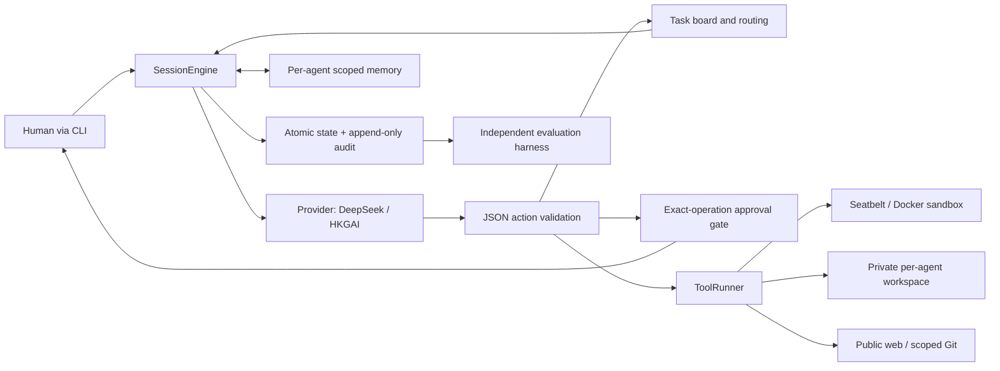

# System Architecture Document

Evolutionary Multi-Agent Collaboration System — HKUST NLP final project.

This document describes what the code in `evoagents/` actually does. Where a
mechanism is a bounded heuristic rather than a guarantee, it says so.

---

## 1. Scope and constraints

| Course constraint | Where it is implemented |
|---|---|
| 1-on-1 and group chat | `SessionEngine.direct_message` (private channel), `_message` (group board) |
| Autonomous delegation and role negotiation | `delegate` / `complete` / `review` actions, model-chosen routing |
| Human-in-the-loop | `ask_human`, tool-approval gate, loop guard, interruption reconciliation |
| Per-agent memory and evolution | `AgentMemory`, `_reflect`, memory injected into every prompt |
| Isolated workspace and execution sandbox | `ToolRunner` per-agent roots, Seatbelt / Docker backends |
| Action space (search, files, code, Git) | `evoagents/tools.py` — 15 tools with per-role allowlists |
| Plain-text outputs only | Write path rejects binary document formats; deliverables are `.md` / `.txt` / `.py` / `.html` |
| Minimal UI | `evo` CLI only (`evoagents/cli.py`) |
| DeepSeek / HKGAI backbone only | `Settings.from_env` rejects any other API host |
| Automatic metric tracking | `_refresh_metrics`, `evoagents/evaluation.py` |

No OpenAI or Anthropic SDK is installed or reachable: the provider layer is a
direct `httpx` client against a chat-completions endpoint, and the configured
base URL is validated against an allowlist of `*.hkgai.net` and
`api.deepseek.com` before any request is made.

---

## 2. Execution model



`SessionEngine` is a single-process, serial actor scheduler. There is no fixed
"developer → tester → release" pipeline: on each turn exactly one agent is
asked for its next action, and that action decides who speaks next. Serial
execution is a deliberate trade-off — it costs parallel throughput and buys
reproducibility, a single writer per workspace, and an audit log whose order
matches causality.

All agents share one model. Heterogeneity comes from role prompt, allowed
tools, private workspace, private memory, and the slice of conversation each
one can see — not from different weights.

### Turn loop

1. Charge the turn to the budget and `fsync` state **before** the API call, so
   a crash or restart cannot refund a consumed turn.
2. Build the prompt (§3).
3. Request one JSON object in JSON-output mode.
4. Normalize unambiguous shorthand, validate, and apply exactly one action.
5. Refresh metrics; enforce the 8-turn worker checkpoint; persist.

Failure handling is per-cause rather than a blanket retry:

| Condition | Behaviour |
|---|---|
| Truncated output (`finish_reason: length`) | Nothing executes; the agent is told to write a smaller section. Three in a row fails the task. |
| Malformed / empty envelope | Up to 3 request attempts, then a protocol error. Partial content is never executed. |
| Transport error, 429, 5xx | Bounded backoff honouring `Retry-After`; then the task **pauses for a human** instead of dying. |
| HTTP 402 (balance exhausted) | **Not retried** — a balance does not refill on its own — but routed to the same pause path, so accepted subtasks survive a top-up. |
| HTTP 401/403/404 | Hard configuration error. These do not resolve by waiting. |
| Invalid action JSON | Corrective message to that agent; three consecutive invalid actions stop the task. |
| Same tool failing identically 3× | Loop guard pauses and asks the human how to change approach. |

### Reasoning-token budget

Both approved backbones are reasoning models, and on both the thinking tokens
are billed *inside* `max_tokens`. Left at the service default, one large
`write_file` can spend the entire turn budget on reasoning and return
`finish_reason: length` with no content at all — the engine then correctly
executes nothing, and the turn is simply lost. Measured on `deepseek-v4-pro`
with the same large code-writing prompt:

| Setting | Reasoning tokens | Content emitted | Latency |
|---|---|---|---|
| service default, 8192 cap | 8192 | none (truncated) | — |
| service default, 32768 cap | 16904 | 5101 chars | 166 s |
| `reasoning_effort: low`, 16384 cap | 1376 | 4754 chars | 23 s |

`EVO_REASONING_EFFORT` therefore sends `reasoning_effort`, or
`thinking: {"type": "disabled"}` for `none`, and drops the parameter only on an
explicit unsupported-parameter error from the service. Reasoning tokens are
counted into metrics separately, because they are real spend even on a turn
that produced nothing.

### Non-action responses

A turn must return one action object. Serving stacks sometimes append
commentary or leak internal tool-call markup after an otherwise complete
object, so the parser takes the first *complete* object and discards non-JSON
remainder, counting it as `recovered_responses` with a `response_recovered`
audit event. This is recovery, not repair: an unterminated object is still
rejected, and a response containing two parseable objects is rejected rather
than letting the parser choose which action to run.

The most common non-action response in practice is a bare JSON **array** of
data — file contents or record rows returned in place of an action. That gets a
named diagnostic pointing at the `write_file` wrapper, because reporting it as
"more than one action" sends the model looking for the wrong defect.

Turn budget exhaustion produces `budget_exhausted`, a *resumable* state — the
human can grant more turns with `evo run NAME --steps N`. Only `failed` is
terminal.

---

## 3. Routing logic

### Action protocol

Each turn returns exactly one JSON object with a top-level `action`:

```json
{"action":"delegate","recipient":"dev","task":"Implement overlap rejection",
 "success_criteria":"Overlapping bookings rejected; adjacent bookings accepted"}
```

| Action | Routing effect |
|---|---|
| `delegate` | Creates a subtask; next turn goes to the assignee. Optional `retry_of` supersedes a failed subtask. |
| `message` | Group post, or a directed post that hands the next turn to one agent. |
| `tool` | Executes in that agent's own sandbox/workspace; the result returns only to that agent. |
| `ask_human` | Suspends the session in `waiting_human` with a concrete question. |
| `complete` | Submits the current subtask (with artifact hashes) back to its delegator. |
| `review` | A *different* agent accepts or rejects a submission. |
| `finish` | Coordinator only; ends the overall task. |
| `remember` | Writes an evidence-tagged lesson into that agent's memory. |

Subtask lifecycle: `assigned → submitted → accepted | failed`. A retry
supersedes the old record, which stays in the metric denominator — so retried
work cannot inflate the completion rate.

### Integrity rules the engine enforces (not prompt suggestions)

- An agent cannot review its own subtask.
- A submission claiming `success: false` cannot be accepted.
- Artifact SHA-256 is recorded at submission and **re-checked at review**; if a
  file changed in between, the review is rejected and a fresh submission is
  required.
- `finish(success=true)` requires at least one peer-accepted subtask and every
  non-superseded subtask accepted.
- A non-coordinator agent that holds the floor for 8 consecutive turns is
  interrupted by a checkpoint message routed to the coordinator.

### Context construction

Each prompt carries: role, protocol, that agent's tool schemas, the task board,
the current subtask, summaries of the two previous tasks, retrieved memory,
remaining turns, and a bounded window of visible messages. The window is capped
at ~65k characters with per-message caps (16k for the three newest, 4k older),
newest-first, so a large pasted web page cannot crowd out the current
instruction. Tool results are visible only to the agent that ran the tool.
The durable audit in `events.jsonl` keeps full untruncated evidence.

When remaining turns fall to the last quarter of the budget, a reminder is
appended telling the team to prioritise the deliverable, handoff, review and
honest disclosure. It does not extend the budget or relax acceptance.

---

## 4. Memory and evolution

Memory is per agent, append-only JSONL, under `memories/<agent_id>/` with two
hard-separated scopes:

- `group.jsonl` — collaboration episodes, peer reviews, outcomes, lessons.
- `private.jsonl` — 1-on-1 human conversations only.

A group-scope retrieval never reads the private file, even for the same agent.

Three write paths:

1. **Peer review** — every accepted/rejected review writes an episode to the
   assignee's memory, tagged with the reviewer's stated reason as evidence.
2. **End-of-task reflection** (`_reflect`) — for each agent, an evidence record
   (task, status, its subtasks, tool-error count) is written first, then a
   bounded model call distils one reusable lesson. If that call fails, the
   evidence-based fallback is still durable; `reflection_failures` counts it.
3. **`remember`** — an agent explicitly saves a lesson, marked as
   agent-authored and not independently verified.

Retrieval is local and dependency-free: character-bigram + word tokenisation,
Jaccard overlap against the task text, duplicate collapsing (keeping an
`occurrences` count and the last ten provenance references), with lessons and
recency used only to break relevance ties. No vector service, no extra API
spend, no network dependency — a deliberate choice given the course's
single-backbone constraint.

**Evolution claim, stated honestly.** Memory changes future prompts, not model
weights. Growth in record counts is *not* evidence of improvement. The testable
claim is cross-task: whether task 2 of a scenario reuses task 1's conventions
and avoids repeating its reviewed failures. §6 reports what was observed rather
than asserting a learning curve.

---

## 5. Isolation

### Workspace

Every agent gets `agents/<agent_id>/`, created `0o700`. Path handling resolves
relative components itself, opens through directory file descriptors with
`O_NOFOLLOW`, and rejects traversal, absolute paths, symlinks and hardlinks.
Artifact verification additionally re-stats after open and compares
`(st_dev, st_ino)` to defeat a swap between check and read.

Agents cannot read each other's workspaces. Sharing is explicit: `send_file`
copies one named file into `inbox/<sender>/<destination>` in the recipient's
workspace and returns a hash receipt. This is why the protocol tells an agent
to transfer artifacts *before* requesting review.

### Code execution

`run_python` never runs as a plain host subprocess. If no sandbox backend is
available it fails loudly rather than degrading.

- **macOS Seatbelt** — default-deny profile; read access limited to system
  runtime, the Python standard library and the agent's own workspace. Network
  and process creation denied; environment allowlisted.
- **Docker** — read-only root filesystem, `--network none`, all capabilities
  dropped, `no-new-privileges`, only the agent's workspace bind-mounted,
  process/CPU/memory limits, timeout-triggered container cleanup.

Because subprocess creation is denied, tests run via import or `runpy` in the
same process. This is a real constraint the agents are told about, and it
shaped how the delivered systems are tested.

### Network and Git

`fetch_url` resolves DNS, verifies **every** resolved address is public, pins
the connection to the validated IP while keeping TLS hostname verification,
re-validates on each redirect, ignores proxy environment inheritance, and caps
body size and time. `search_web` is an RSS query whose results are labelled
`untrusted` and annotated with lexical-overlap warnings — search hits are leads,
not evidence.

Git operations are confined to the agent's own workspace with external config,
hooks, external diff drivers and credential helpers disabled. Push is limited to
explicit HTTPS GitHub repository and branch targets, requires human approval,
and reads its token from the environment only at that moment — the token never
enters session JSON or any agent prompt.

### Trust boundary

Two sentences worth being explicit about: this design is not a defence against
an attacker who already controls the host OS, and prompt text is not treated as
a security boundary. Every critical restriction is enforced in the tool layer
and re-checked in the orchestrator, so a persuasive prompt injection cannot
widen an agent's permissions.

---

## 6. Human-in-the-loop and recovery

`ask_human` stores a specific question and suspends. Critical tools
(`run_python`, `delete_file`, `git_commit`, `git_push`) additionally require
explicit approval of the *exact* operation: the pending request records the tool
name, the full arguments, and a SHA-256 fingerprint of the whole workspace. If
either changed when the human answers, the approval is stale and must be
re-requested. Batch evaluation never auto-approves these.

State is saved by write-temp → `fsync` → atomic replace. Before a tool runs,
an `inflight` record is persisted and cleared on completion. If the process dies
after an external side effect but before the result is recorded, reload does not
replay the operation — it asks the human to confirm the real outcome. The system
does not claim distributed exactly-once semantics.

---

## 7. Observability

`events.jsonl` records every turn, action, tool call and result, approval, and
protocol error, with credential patterns redacted at the boundary. `state.json`
holds the task board and metrics. Each run is archived to `runs/<task_id>.json`
when the team starts its next task, so a team's history survives task switches.

Tracked metrics: `elapsed_seconds` (wall clock including human wait),
`active_seconds` (engine + API + tools only), `agent_turns`, `tool_calls`,
`tool_errors`, `invalid_actions`, `recovered_responses`, `output_limit_errors`,
`fatal_errors`, `subtasks_total`, `subtasks_accepted`,
`subtask_completion_rate`, `model_claimed_success`,
`peer_reviewed_completion`, and before/after memory counts per agent.

Token usage is recorded from the service's own `usage` fields — prompt,
completion and reasoning tokens, request and call counts, and any provider
switch. Usage is recorded even for a truncated or protocol-invalid response;
a network timeout that returns no body contributes nothing. Counters belong
to the current CLI process and restart on a new `evo respond`, so the saved
per-task totals can undercount a resumed task. They are not a complete billing
ledger: monetary cost requires matching account records, and cache savings
cannot be measured without cache-hit counts.

One metric needs reading with care. `subtask_completion_rate` counts
*peer-accepted* subtasks, and a reviewer may legitimately accept a teammate's
honest report that it produced no artifact. An accepted subtask is therefore
not proof of a deliverable; only the independent artifact checks are.

The evaluation harness separates two things that are easy to conflate:
`peer_reviewed_completion` is what the agents concluded about themselves, while
`verified_task_completion_rate` counts only cases where the harness itself
re-read the artifacts and every declared check passed. A case with no
independent checks is flagged `requires_manual_review`, never scored as a pass.

---

## 8. Known limits

- Sandboxed Python is standard-library only; no package manager, no host shell,
  no long-running service. Full application source can be generated, but running
  code with third-party dependencies needs a pre-built trusted image.
- Docker argument construction and failure handling are unit-tested, but no
  Docker daemon is installed on the development machine, so container execution
  itself is unverified here. Seatbelt execution is tested for real.
- macOS provides no hard resident-memory cap, and neither backend enforces a
  total workspace quota.
- Web fetching cannot reach login-gated sites; DNS resolution happens in the OS
  and cannot be interrupted by the HTTP deadline, so a resolver failure can
  stretch a request beyond the configured timeout.
- Serial scheduling means wall-clock time scales with turn count.
- The Python sandbox does not validate JavaScript or browser layout. HTML
  deliverables require separate browser checks; the test report records which
  artifacts have that evidence. Static analysis alone is not visual acceptance.
