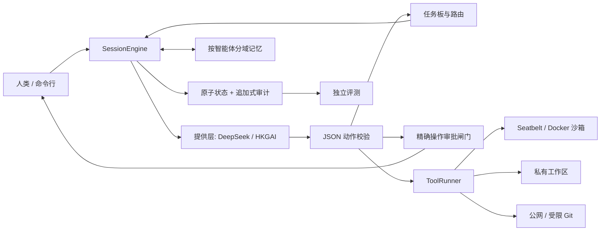

# 系统架构文档

进化式多智能体协作系统 —— 香港科技大学 NLP 期末项目。

本文描述 `evoagents/` 中代码的实际行为。凡属有界启发式而非保证的机制，文中均明确说明。英文版见 [system-architecture.md](system-architecture.md)。

---

## 1. 范围与课程约束

| 课程约束 | 实现位置 |
|---|---|
| 一对一与群聊 | `SessionEngine.direct_message`（私聊通道）、`_message`（群组任务板） |
| 自主委派与角色协商 | `delegate` / `complete` / `review` 动作，由模型决定路由 |
| 人类在环（HITL） | `ask_human`、工具审批闸门、循环守卫、中断对账 |
| 每个智能体的记忆与进化 | `AgentMemory`、`_reflect`，记忆注入每次提示 |
| 独立工作区与执行沙箱 | `ToolRunner` 的按智能体根目录、Seatbelt / Docker 后端 |
| 动作空间（搜索、文件、代码、Git） | `evoagents/tools.py` —— 15 个工具，按角色白名单 |
| 仅纯文本产物 | 写入路径拒绝二进制文档格式；交付物为 `.md` / `.txt` / `.py` / `.html` |
| 极简界面 | 仅 `evo` 命令行（`evoagents/cli.py`） |
| 仅 DeepSeek / HKGAI 主干 | `Settings.from_env` 拒绝其他 API 主机 |
| 自动记录指标 | `_refresh_metrics`、`evoagents/evaluation.py` |

系统未安装也无法访问 OpenAI 或 Anthropic SDK：提供层是直接基于 `httpx` 的 chat-completions 客户端，且在发出任何请求之前，就会用 `*.hkgai.net` 与 `api.deepseek.com` 的白名单校验 base URL。

---

## 2. 执行模型



`SessionEngine` 是单进程串行 actor 调度器。系统**没有**固定的「开发 → 测试 → 发布」流水线：每一回合只询问一个智能体的下一个动作，而该动作决定下一位发言者。串行执行是刻意的取舍——牺牲并行吞吐，换取可复现性、每个工作区单一写入者，以及顺序与因果一致的审计日志。

所有智能体共用同一个模型。异构性来自角色提示、允许的工具、私有工作区、私有记忆，以及各自可见的对话切片，而非不同权重。

### 回合循环

1. 先扣减回合预算并 `fsync` 状态，**然后**才发起 API 请求，使崩溃或重启无法退回已消耗的回合。
2. 构建提示（见 §3）。
3. 以 JSON 输出模式请求一个 JSON 对象。
4. 规范化无歧义的简写，校验，并且只执行一个动作。
5. 刷新指标；执行「工作者连续 8 回合」检查点；持久化。

失败处理按成因区分，而非一律重试：

| 情形 | 行为 |
|---|---|
| 输出截断（`finish_reason: length`） | 不执行任何动作，提示该智能体改写更小的片段。连续三次则任务失败。 |
| 响应结构异常 / 内容为空 | 最多 3 次请求尝试，之后报协议错误。残缺内容绝不执行。 |
| 传输错误、429、5xx | 尊重 `Retry-After` 的有界退避；之后任务**暂停等待人类**而非终止。 |
| HTTP 402（余额耗尽） | **不重试**——余额不会自行恢复——但同样进入暂停路径，使已验收子任务在充值后得以保留。 |
| HTTP 401/403/404 | 硬性配置错误，等待不会使其恢复。 |
| 动作 JSON 无效 | 向该智能体发送纠正消息；连续三次无效动作终止任务。 |
| 同一工具以相同错误失败 3 次 | 循环守卫暂停并询问人类如何改变思路。 |

回合预算耗尽产生 `budget_exhausted`，这是**可恢复**状态，人类可用 `evo run NAME --steps N` 追加回合。只有 `failed` 是终止状态。

### 推理 token 预算

两个获准的主干都是推理模型，且其思考 token 都计入 `max_tokens`。若保持服务默认设置，一次较大的 `write_file` 可能把整个回合预算耗在推理上，返回 `finish_reason: length` 却没有任何内容——引擎随后正确地不执行任何动作，这一回合则白白浪费。在同一个大型代码编写提示上对 `deepseek-v4-pro` 的实测：

| 设置 | 推理 token | 实际输出 | 延迟 |
|---|---|---|---|
| 服务默认，上限 8192 | 8192 | 无（被截断） | — |
| 服务默认，上限 32768 | 16904 | 5101 字符 | 166 秒 |
| `reasoning_effort: low`，上限 16384 | 1376 | 4754 字符 | 23 秒 |

因此 `EVO_REASONING_EFFORT` 会发送 `reasoning_effort`，取值 `none` 时发送 `thinking: {"type": "disabled"}`；仅当服务明确返回「不支持该参数」时才移除它。推理 token 单独计入指标，因为即便该回合毫无产出，这部分消耗依然真实发生。

### 非动作响应

每回合必须返回一个动作对象。某些服务栈会在一个本已完整的对象之后追加解说文字，或泄漏内部工具调用标记，因此解析器取**第一个完整**对象并丢弃其后的非 JSON 残余，同时计入 `recovered_responses` 并记录 `response_recovered` 审计事件。这是**恢复而非修补**：未闭合的对象仍被拒绝；若响应中含有两个可解析对象，同样拒绝，而不让解析器替模型选择执行哪一个动作。

实践中最常见的非动作响应，是以数据数组（文件内容或记录行）代替动作的裸 JSON **数组**。此类响应会得到专门的诊断信息，指向 `write_file` 包装写法——因为把它报成「含有多个动作」会让模型去排查错误的缺陷。

---

## 3. 路由逻辑

### 动作协议

每回合返回且仅返回一个带顶层 `action` 的 JSON 对象：

```json
{"action":"delegate","recipient":"dev","task":"实现重叠拒绝",
 "success_criteria":"重叠预订被拒绝；相邻预订被接受"}
```

| 动作 | 路由效果 |
|---|---|
| `delegate` | 创建子任务，下一回合交给受派人。可选 `retry_of` 用于替代失败的子任务。 |
| `message` | 群组发言，或指定收件人并把下一回合交给该智能体。 |
| `tool` | 在该智能体自己的沙箱/工作区执行；结果只回到该智能体。 |
| `ask_human` | 以具体问题挂起会话，进入 `waiting_human`。 |
| `complete` | 把当前子任务连同产物哈希提交回委派者。 |
| `review` | 由**另一位**智能体接受或拒绝提交。 |
| `finish` | 仅协调者可用，结束整体任务。 |
| `remember` | 将带证据标记的经验写入该智能体记忆。 |

子任务生命周期：`assigned → submitted → accepted | failed`。重试会 supersede 旧记录，而旧记录仍留在指标分母中——因此重试无法抬高完成率。

### 引擎强制执行的完整性规则（并非提示词建议）

- 智能体不能评审自己的子任务。
- 声明 `success: false` 的提交不可被接受。
- 产物 SHA-256 在提交时记录，并在**评审时重新校验**；若文件在此期间变动，评审被拒绝并要求重新提交。
- `finish(success=true)` 要求至少一个子任务经同伴验收，且所有未被 supersede 的子任务均已验收。
- 非协调者连续占用 8 回合后，由检查点消息把发言权交回协调者。

### 上下文构建

每次提示包含：角色、协议、该智能体的工具 schema、任务板、当前子任务、前两个任务的摘要、检索到的记忆、剩余回合数，以及有界的可见消息窗口。窗口上限约 65k 字符（最新三条各 16k、更早各 4k），由新到旧，以免大段网页内容挤掉当前指令。工具结果仅对执行该工具的智能体可见。`events.jsonl` 中的持久审计保留未截断的完整证据。

当剩余回合降至预算最后四分之一时，会追加提醒，要求优先完成必需交付物、交接、评审与诚实披露。该提醒不会延长预算，也不会放宽验收标准。

---

## 4. 记忆与进化

记忆按智能体存放于 `memories/<agent_id>/`，为追加式 JSONL，并硬性分为两个域：

- `group.jsonl` —— 协作经历、同伴评审、结果、经验。
- `private.jsonl` —— 仅一对一人类对话。

group 域的检索**绝不**读取 private 文件，即使二者属于同一智能体。

三条写入路径：

1. **同伴评审** —— 每次接受/拒绝都会向受派人记忆写入一条经历，并以评审者陈述的理由作为证据标签。
2. **任务结束复盘**（`_reflect`） —— 先为每个智能体写入证据记录（任务、状态、其子任务、工具错误数），再进行一次有界模型调用提炼可复用经验。若该调用失败，基于证据的回退记录依然持久化，并计入 `reflection_failures`。
3. **`remember`** —— 智能体显式保存经验，标记为「智能体自述、未经独立验证」。

检索完全本地且无额外依赖：字符二元组 + 词元切分，与任务文本做 Jaccard 重叠，折叠重复项（保留 `occurrences` 计数与最近十条来源引用），仅在相关度持平时才用「是否为经验」与「新近程度」破除平局。不依赖向量服务、不产生额外 API 费用、不依赖网络——这是在课程单一主干约束下的刻意选择。

**关于「进化」的诚实表述。** 记忆改变的是后续提示，而非模型权重。记录条数增长**不是**性能提升的证据。可检验的命题是跨任务的：某场景的第二个任务是否复用了第一个任务的约定，并避免重复其已被评审指出的失败。详见测试报告中的实测结果，而非在此断言学习曲线。

---

## 5. 隔离

### 工作区

每个智能体获得 `agents/<agent_id>/`，以 `0o700` 创建。路径处理自行解析相对片段，通过目录文件描述符以 `O_NOFOLLOW` 打开，并拒绝目录穿越、绝对路径、符号链接与硬链接。产物校验还会在 open 之后重新 stat，并比对 `(st_dev, st_ino)`，以挫败「检查与读取之间被掉包」的竞态。

智能体之间不能读取彼此工作区。共享必须显式进行：`send_file` 将一个指定文件复制到接收方工作区的 `inbox/<sender>/<destination>`，并返回哈希回执。这也是协议要求「请求评审**之前**先传输产物」的原因。

### 代码执行

`run_python` 绝不以普通宿主子进程方式运行。若没有可用沙箱后端，它会明确失败而非降级。

- **macOS Seatbelt** —— 默认拒绝策略；读取权限仅限系统运行库、Python 标准库与该智能体自己的工作区。拒绝网络与进程创建，环境变量白名单化。
- **Docker** —— 根文件系统只读、`--network none`、丢弃全部 capabilities、`no-new-privileges`、仅挂载该智能体工作区、限制进程/CPU/内存、超时后清理容器。

由于进程创建被拒绝，测试需通过 import 或同进程内 `runpy` 进行。这是向智能体明确告知的真实约束，并实际塑造了交付系统的测试方式。

### 网络与 Git

`fetch_url` 解析 DNS 后校验**每一个**解析出的地址均为公网地址，将连接固定到已校验的 IP 同时保留 TLS 主机名校验，每次重定向重新校验，忽略代理环境继承，并限制响应体积与耗时。`search_web` 是 RSS 查询，其结果标记为 `untrusted` 并附带词汇重叠告警——搜索命中只是线索，不是证据。

Git 操作限定在智能体自己的工作区，并禁用外部配置、钩子、外部 diff 驱动与凭据助手。推送仅允许明确的 HTTPS GitHub 仓库与分支目标，需人类审批，且仅在该时刻从环境读取令牌——令牌不进入会话 JSON，也不进入任何智能体提示。

### 信任边界

有两点值得明说：本设计**不**防御已控制宿主操作系统的攻击者，提示词文本也**不**被当作安全边界。所有关键限制都在工具层实施并在编排层复查，因此再有说服力的提示注入也无法扩大智能体的权限。

---

## 6. 人类在环与恢复

`ask_human` 保存具体问题并挂起。关键工具（`run_python`、`delete_file`、`git_commit`、`git_push`）还要求对**具体操作**显式审批：待审请求记录工具名、完整参数，以及整个工作区的 SHA-256 指纹。若人类回答时二者任一已变化，该审批即为过期，必须重新申请。批量评测绝不自动批准这些操作。

状态保存采用「写临时文件 → `fsync` → 原子替换」。工具执行前先持久化 `inflight` 记录，完成后清除。若进程在产生外部副作用之后、记录结果之前崩溃，重新加载时**不会**重放该操作，而是请人类确认真实结果。系统不声称具备分布式 exactly-once 语义。

---

## 7. 可观测性

`events.jsonl` 记录每一回合、动作、工具调用与结果、审批以及协议错误，并在边界处脱敏凭据模式。`state.json` 保存任务板与指标。团队开始下一个任务时，当前运行会归档到 `runs/<task_id>.json`，因此团队历史能跨任务切换留存。

已跟踪指标：`elapsed_seconds`（含等待人类的墙钟时间）、`active_seconds`（仅引擎 + API + 工具）、`agent_turns`、`tool_calls`、`tool_errors`、`invalid_actions`、`recovered_responses`、`output_limit_errors`、`fatal_errors`、`subtasks_total`、`subtasks_accepted`、`subtask_completion_rate`、`model_claimed_success`、`peer_reviewed_completion`，以及每个智能体前后的记忆计数。

Token 用量取自服务自身的 `usage` 字段——prompt、completion 与 reasoning token、请求与调用次数，以及任何提供方切换。即便响应被截断或协议无效也会记录用量；未返回响应体的网络超时不贡献数据。计数属于当前 CLI 进程，新的 `evo respond` 会重新计数，因此保存的逐任务总量可能少计恢复前的调用。这不是完整账单：货币成本需要对应时段的账户记录，没有缓存命中计数也不能测算缓存节省。

有一个指标需要谨慎解读。`subtask_completion_rate` 统计的是**经同伴验收**的子任务，而评审者完全可能合理地接受队友「我确实没有产出任何产物」的诚实汇报。因此，子任务被验收**并不**等于存在交付物；只有独立产物检查才能证明这一点。

评测框架刻意区分两件容易混淆的事：`peer_reviewed_completion` 是智能体对自身的结论，而 `verified_task_completion_rate` 只统计框架自己重新读取产物、且全部声明的检查均通过的案例。没有独立检查的案例被标记为 `requires_manual_review`，绝不自动计为通过。

---

## 8. 已知限制

- 沙箱内 Python 仅限标准库；没有包管理器、没有宿主 shell、没有常驻服务。可以生成完整应用源码，但运行依赖第三方库的代码需要预先构建可信镜像。
- Docker 的参数构造与故障处理有单元测试覆盖，但开发机未安装 Docker 守护进程，因此容器执行本身在此未经验证。Seatbelt 执行则经过真实测试。
- macOS 不提供硬性常驻内存上限，两种后端都没有工作区总配额。
- 网页抓取无法访问需登录的站点；DNS 解析发生在操作系统层且无法被 HTTP 截止时间打断，因此解析器故障可能使请求超出配置的超时时间。
- 串行调度意味着墙钟时间随回合数线性增长。
- Python 沙箱不验证 JavaScript 或浏览器布局。HTML 交付物需要单独的浏览器检查，哪些产物已有此类证据以测试报告为准；仅有静态分析不等于视觉验收。
